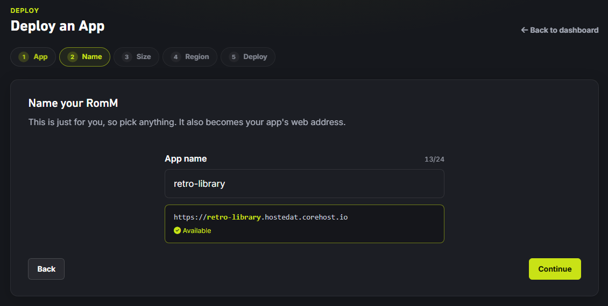
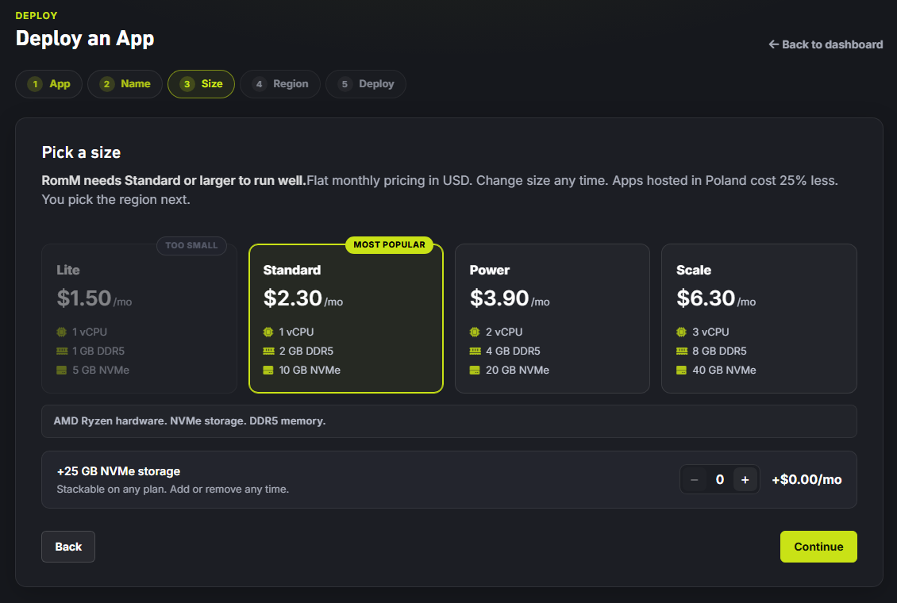
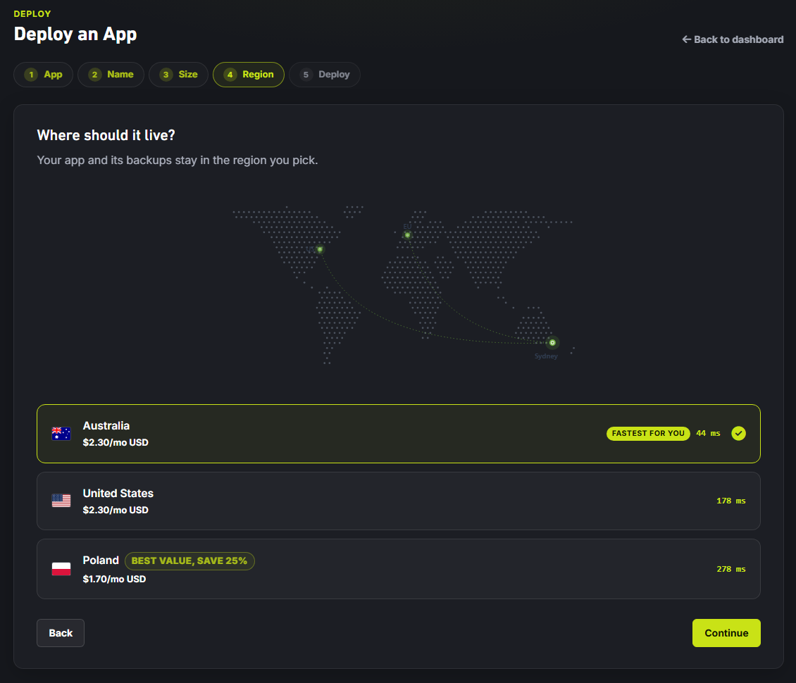
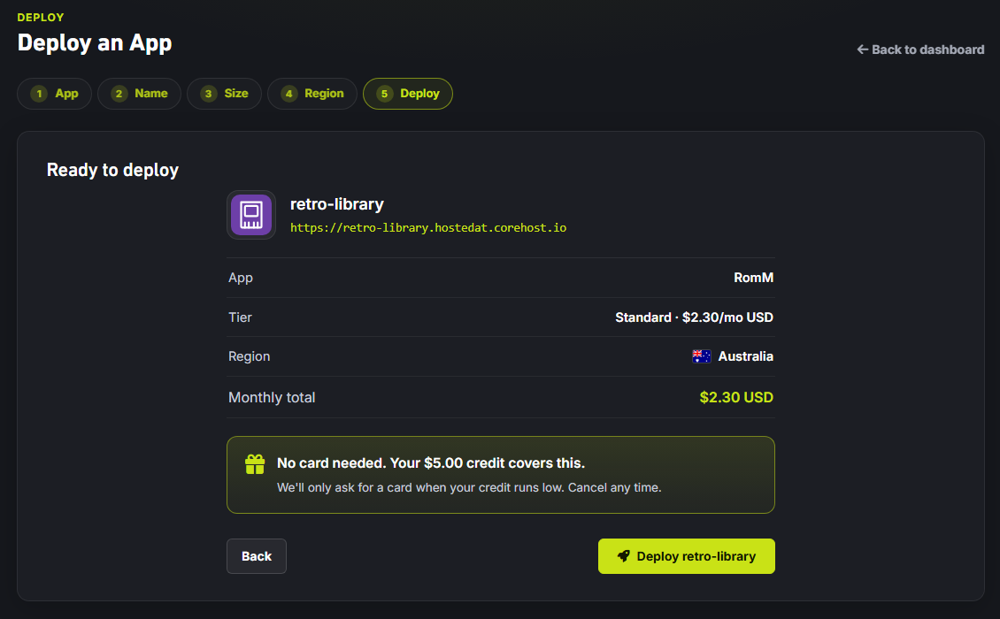
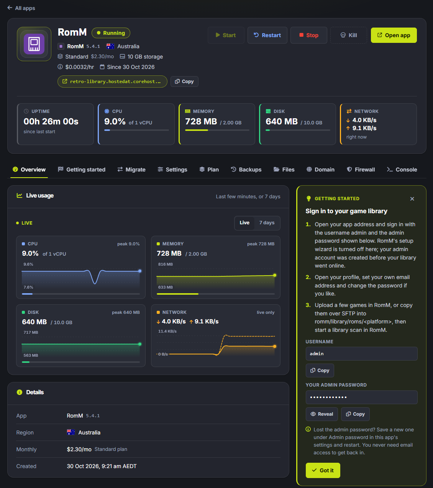
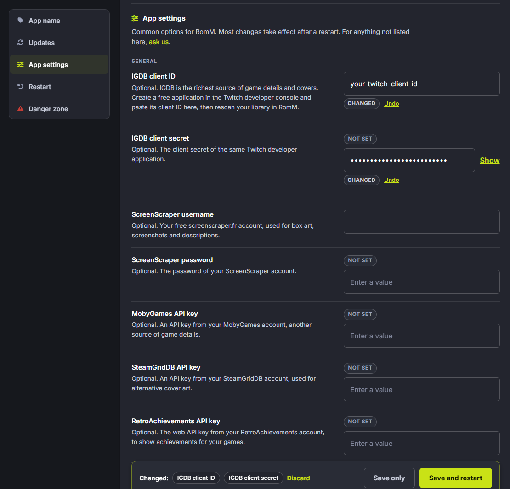
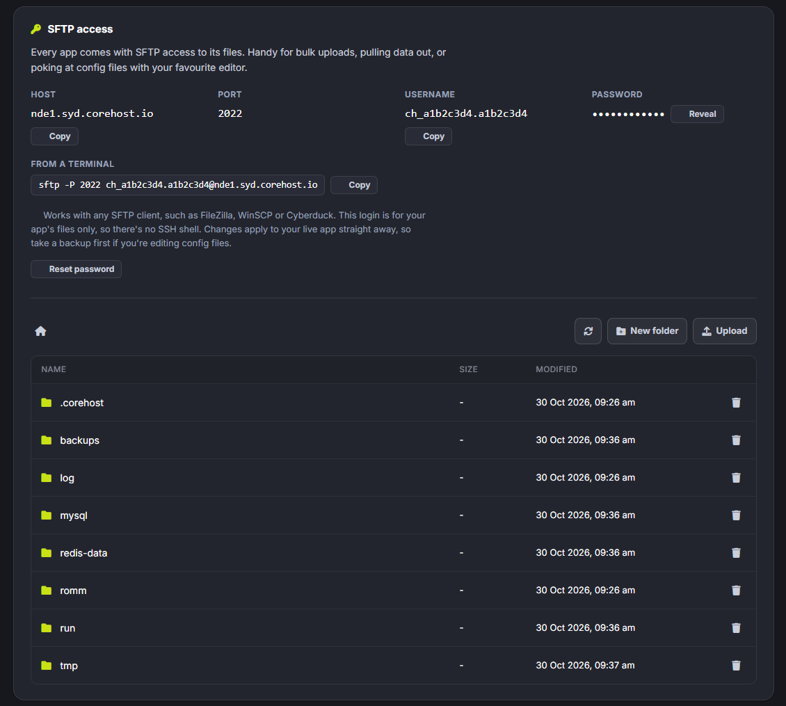
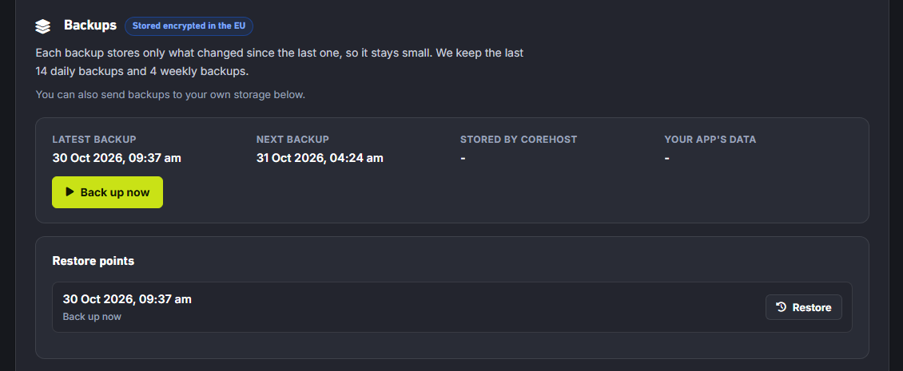
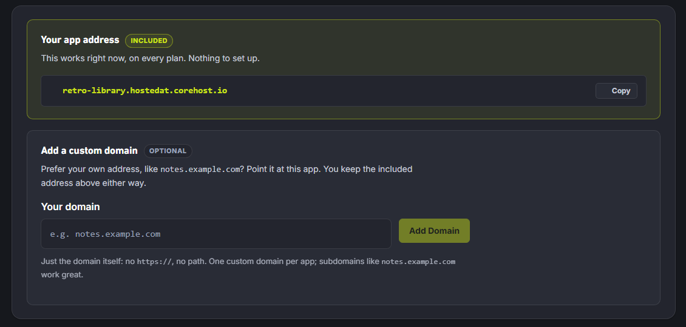

# CoreHost

[CoreHost](https://corehost.io/p/romm) runs RomM as a managed app. Each customer gets their own instance, with the database, cache, and scanner already set up next to the web app. CoreHost tests each RomM release before rolling it out, and instances run the same unmodified RomM that the rest of these docs describe.

[](https://corehost.io/p/romm)

<!-- prettier-ignore -->
!!! info "Supporting RomM"
    CoreHost shares a portion of the revenue from RomM instances with the project.

## Plans

Standard (1 vCPU, 2 GB RAM, 10 GB NVMe) is the smallest plan that fits RomM, and Power and Scale add more CPU, memory, and storage. Your games count against the plan's storage, so a large collection needs a bigger plan or extra 25 GB storage blocks, which you can add to any plan.

## Install

Open the [RomM app on CoreHost](https://corehost.io/p/romm). The name you give the app becomes its address, `https://<name>.hostedat.corehost.io`.



Then pick Standard (or a larger plan) and a region, which is also where the instance's backups stay.







## First sign-in

RomM's setup wizard is turned off on CoreHost, because the `admin` user is created before the instance goes online. Its generated password is on the app page in the CoreHost panel. Sign in at the app address with those credentials, then set your own email and password from your profile. If you lose the password, reset it under **Admin password** in the app settings and restart the app.



## Metadata providers

Set up metadata provider credentials before your first scan, because they decide how well games get matched (see [Metadata Providers](../getting-started/metadata-providers.md)). Hasheous and LaunchBox need no account, while the others take an API key. On CoreHost the keys for IGDB, ScreenScraper, MobyGames, SteamGridDB, and RetroAchievements go in the app settings, and they take effect after a restart.



## Adding ROMs

Small batches can go through the [upload dialog](../using/uploads.md) in the browser. For a larger collection, copy files over SFTP into `romm/library/roms/<platform>` (and BIOS files into `romm/library/bios/<platform>`). The SFTP host, username, and password are in the CoreHost panel, and the port is `2022`:

```bash
sftp -P 2022 <username>@<host>
```

Any SFTP client works, such as FileZilla, WinSCP, or Cyberduck. The login only reaches the app's files and doesn't give you an SSH shell.



Platform folder names must follow RomM's naming (see [Folder Structure](../getting-started/folder-structure.md)). After the upload finishes, run a scan (see [Your First Scan](../getting-started/first-scan.md)). If you add files over SFTP often, turn on the nightly library scan so new files get picked up without a manual run.

## Backups and updates

CoreHost backs up every instance daily, keeping the last 14 daily and 4 weekly backups, and any of them can be restored from the panel in one click. It can also send encrypted backups to your own S3-compatible storage. Updates run on a copy of the instance first and roll back automatically if health checks fail. CoreHost deletes an instance's data 14 days after you cancel it, so copy your files off over SFTP first if you want to keep them.



## Custom domain

The app address keeps working when you add your own domain, and each app takes one custom domain. Point it at the instance with a CNAME and a TXT verification record, and CoreHost issues the TLS certificate. If your domain uses CAA records, allow `letsencrypt.org`.



## Getting help

For problems with billing, the instance, backups, or the panel, contact [CoreHost support](https://corehost.io/control/support), since they run the hosting. For issues with the app itself, try the [RomM Discord](https://discord.gg/romm) or:

- [Scanning Troubleshooting](../troubleshooting/scanning.md) for matching and ingest problems
- [Authentication Troubleshooting](../troubleshooting/authentication.md) for login issues
